# 2. Instalación y Configuración de Minikube y Kubectl

En esta guía paso a paso aprenderemos a desplegar un clúster local de **Kubernetes** en **Ubuntu** utilizando **Minikube**. Exploraremos el despliegue mediante el hipervisor **VirtualBox**, la configuración de la herramienta CLI oficial **kubectl**, el autocompletado en terminal, la gestión del ciclo de vida y la alternativa con el driver de **Docker**.

---

## 1. Instalación de Minikube sobre Ubuntu con VirtualBox

Minikube es una herramienta que ejecuta un clúster de Kubernetes mononodo dentro de una máquina virtual o un contenedor en tu equipo de desarrollo. Es la forma estándar y recomendada para aprender y hacer pruebas locales.

### 1.1. Descarga e instalación del binario de Minikube

El primer paso consiste en descargar el binario ejecutable compilado para arquitectura x86_64 (amd64) desde el repositorio oficial de Minikube y moverlo a una ruta del sistema incluida en el `$PATH` (como `/usr/local/bin`).

Ejecutamos los siguientes comandos:

```bash
# Descargar el binario de Minikube
curl -LO https://github.com/kubernetes/minikube/releases/latest/download/minikube-linux-amd64

# Instalar el binario con los permisos adecuados en /usr/local/bin y limpiar el archivo descargado
sudo install minikube-linux-amd64 /usr/local/bin/minikube && rm minikube-linux-amd64
```

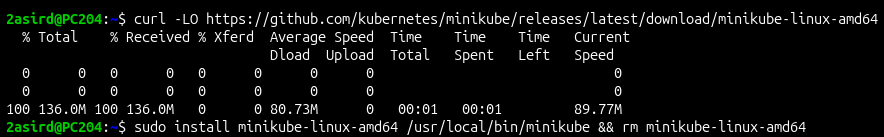

> **Explicación del comando:**
> - `curl -LO`: Descarga siguiendo redirecciones (`-L`) y conserva el nombre de archivo remoto (`-O`).
> - `sudo install ... /usr/local/bin/minikube`: Copia el binario asignándole automáticamente permisos de ejecución (`+x`) para todos los usuarios del sistema.
> - `rm minikube-linux-amd64`: Elimina el instalador temporal una vez copiado.

---

### 1.2. Verificación de la versión instalada

Para asegurarnos de que el binario se encuentra correctamente ubicado y operativo en nuestro entorno, consultamos su versión:

```bash
minikube version
```

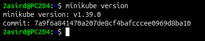

Como podemos observar en la captura, se ha instalado la versión **v1.39.0** con su commit correspondiente.

---

### 1.3. Selección del controlador (Driver) VirtualBox

Minikube soporta distintos manejadores de virtualización (*drivers*). Cuando deseamos aislar completamente el clúster en una máquina virtual gestionada por Oracle VirtualBox, podemos indicarlo explícitamente mediante el parámetro `--driver=virtualbox`:

```bash
minikube start --driver=virtualbox
```


> [!NOTE]
> Para utilizar este controlador es imprescindible tener instalado previamente **VirtualBox** en Ubuntu (`sudo apt install virtualbox virtualbox-ext-pack`) y tener habilitada la virtualización VT-x/AMD-V en la BIOS/UEFI de la máquina.

---

### 1.4. Inicialización del Clúster (`minikube start`)

Al ejecutar el arranque, Minikube detecta el entorno, descarga la imagen ISO optimizada para la máquina virtual y aprovisiona el plano de control:

```bash
minikube start
```

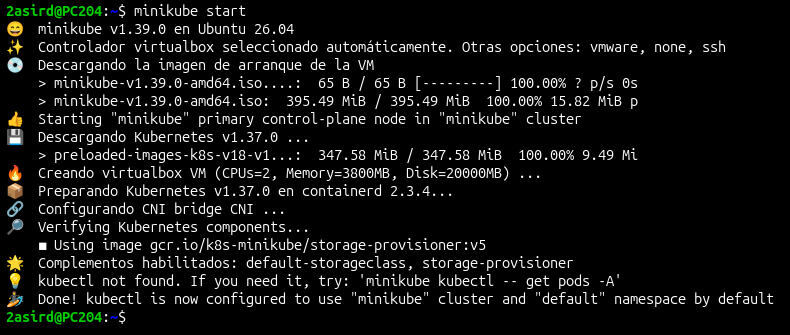

**Detalles del proceso observados en la salida:**
1. **Detección automática del controlador:** Selecciona `virtualbox` como driver disponible.
2. **Descarga de componentes:**
   - Imagen ISO base: `minikube-v1.39.0-amd64.iso` (~395 MB).
   - Imágenes de precarga de Kubernetes: `v1.37.0` (~347 MB).
3. **Creación de la Máquina Virtual:**
   - **CPUs asignadas:** 2 vCPUs.
   - **Memoria RAM:** 3800 MB (~3.8 GB).
   - **Disco:** 20 GB.
4. **Entorno de ejecución (Runtime):** Despliega Kubernetes v1.37.0 sobre el runtime de contenedores **containerd 2.3.4**.
5. **Configuración de red y CNI:** Aplica el puente de red `bridge CNI`.
6. **Complementos activados por defecto:** `default-storageclass` y `storage-provisioner`.
7. **Kubeconfig:** Configura automáticamente el archivo local `~/.kube/config` para apuntar al nuevo clúster `minikube`.

---

### 1.5. Verificación del estado del clúster

Una vez concluido el arranque, verificamos que todos los servicios esenciales del nodo de control estén en estado de ejecución (*Running*):

```bash
minikube status
```

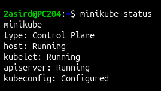

* **type:** `Control Plane` (actúa como plano de control y nodo de trabajo en entornos mononodo).
* **host:** `Running` (la máquina virtual en VirtualBox está encendida).
* **kubelet:** `Running` (el agente de nodo de K8s está activo y reportando).
* **apiserver:** `Running` (la API de Kubernetes está lista para recibir peticiones).
* **kubeconfig:** `Configured` (el contexto local de autenticación está enlazado correctamente).

---

### 1.6. Inspección de perfiles activos

Minikube permite gestionar múltiples clústeres locales a través de perfiles. Para consultar el perfil en ejecución, su dirección IP y detalles de red:

```bash
minikube profile list
```

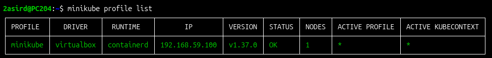

La tabla nos muestra:
- **Perfil activo (`*`):** `minikube`
- **Driver:** `virtualbox`
- **Runtime:** `containerd`
- **IP asignada a la VM:** `192.168.59.100` (accesible desde la red solo-anfitrión de VirtualBox)
- **Versión de K8s:** `v1.37.0`
- **Nodos:** `1` (Estado: `OK`)

---

### 1.7. Instalación y verificación de `kubectl`

`kubectl` es la interfaz de línea de comandos estándar de Kubernetes para interactuar con la API del clúster.

#### Descarga e instalación:
```bash
# 1. Descargar la última versión binaria estable de kubectl
curl -LO "https://dl.k8s.io/release/$(curl -L -s https://dl.k8s.io/release/stable.txt)/bin/linux/amd64/kubectl"

# 2. Instalar el binario con permisos de ejecución en /usr/local/bin
sudo install -o root -g root -m 0755 kubectl /usr/local/bin/kubectl

# 3. Comprobar la versión instalada (cliente y servidor)
kubectl version
```

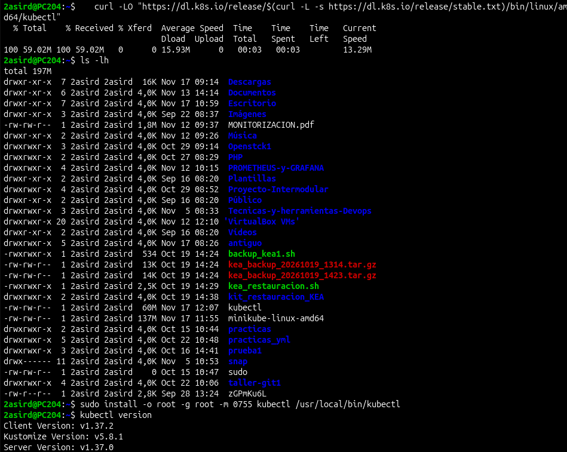

En la captura se evidencia:
- **Client Version:** `v1.37.2` (herramienta CLI en tu máquina Ubuntu).
- **Server Version:** `v1.37.0` (versión del clúster de Kubernetes en Minikube).

---

### 1.8. Comprobación del nodo con `kubectl`

Para confirmar que `kubectl` se comunica correctamente con el clúster de Minikube y que el nodo está operativo, consultamos los nodos con el modificador `-o wide`:

```bash
kubectl get nodes -o wide
```

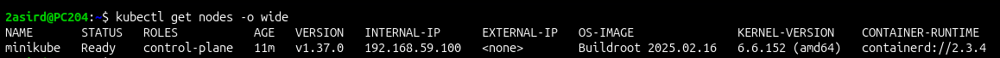

* **NAME:** `minikube`
* **STATUS:** `Ready` (listo para programar y alojar Pods).
* **ROLES:** `control-plane`
* **INTERNAL-IP:** `192.168.59.100`
* **OS-IMAGE:** `Buildroot 2025.02.16` (sistema operativo ligero integrado en la ISO de Minikube).
* **KERNEL-VERSION:** `6.6.152 (amd64)`
* **CONTAINER-RUNTIME:** `containerd://2.3.4`

---

## 2. Activación del Autocompletado de Comandos

Trabajar con `kubectl` y `minikube` requiere escribir comandos y nombres de recursos extensos. Activar el autocompletado en el shell Bash aumenta la productividad y evita errores tipográficos.

### 2.1. Carga para la sesión actual

Podemos habilitar de forma inmediata el autocompletado cargando las funciones en el shell en ejecución:

```bash
source <(kubectl completion bash)
source <(minikube completion bash)
```

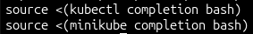

### 2.2. Configuración permanente en `~/.bashrc`

Para que esté disponible automáticamente cada vez que abramos una nueva terminal, agregamos las directivas y un alias práctico (`k` para `kubectl`) a nuestro archivo `.bashrc`:

```bash
# Autocompletado permanente de kubectl y alias rápido
echo "source <(kubectl completion bash)" >> ~/.bashrc
echo "alias k=kubectl" >> ~/.bashrc
echo "complete -o default -F __start_kubectl k" >> ~/.bashrc

# Autocompletado permanente de minikube
echo "source <(minikube completion bash)" >> ~/.bashrc

# Recargar el archivo de configuración en la sesión actual
source ~/.bashrc
```

> [!TIP]
> Ahora puedes escribir `k get no` y pulsar `[TAB]` para autocompletar automáticamente a `kubectl get nodes`.

---

## 3. Eliminación y Limpieza del Clúster

Cuando deseamos reiniciar el entorno desde cero, liberar recursos de memoria RAM/disco o eliminar máquinas virtuales huérfanas, Minikube proporciona el comando `delete`.

Para destruir todas las instancias y perfiles creados:

```bash
minikube delete --all
```

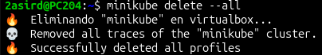

**Salida obtenida:**
- 🔥 Eliminando "minikube" en virtualbox...
- 💀 Removed all traces of the "minikube" cluster.
- 🔥 Successfully deleted all profiles.

> [!WARNING]
> Este comando destruye la máquina virtual de VirtualBox y todos los datos, Pods, volúmenes y configuraciones alojados en el clúster.

---

## 4. Instalación de Minikube sobre Ubuntu con Docker

Como alternativa a VirtualBox, Minikube puede ejecutarse directamente como un contenedor dentro de Docker en el sistema operativo anfitrión. Este método es el más popular actualmente debido a su **rapidez de arranque**, su **menor consumo de memoria RAM** (sin el sobrecoste de un hipervisor tradicional) y su **facilidad de configuración**.

### 4.1. Requisitos previos

Tener instalado el motor de Docker y asegurarse de que el usuario pertenezca al grupo `docker` para interactuar con el socket de Docker sin requerir privilegios de superusuario (`sudo`):

```bash
# Instalar Docker si no estuviese presente
sudo apt update && sudo apt install -y docker.io

# Añadir el usuario actual al grupo docker y aplicar cambios de grupo
sudo usermod -aG docker $USER && newgrp docker
```

---

### 4.2. Inicialización del clúster con el controlador Docker

Indicamos a Minikube que emplee el driver de Docker mediante el parámetro `--driver=docker`:

```bash
minikube start --driver=docker
```

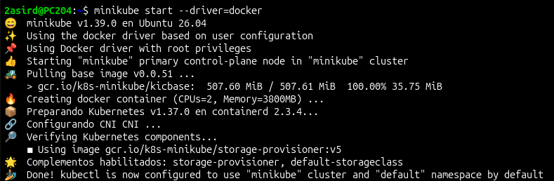

**Análisis de la salida en terminal:**
1. **Detección del driver:** `Using the docker driver based on user configuration`.
2. **Descarga de la imagen base KIC (Kubernetes in Container):** Descarga la imagen optimizada `gcr.io/k8s-minikube/kicbase:v0.0.51` (~507 MB) que emula el nodo completo dentro de un contenedor Docker.
3. **Creación del contenedor:** Asigna dinámicamente recursos (`CPUs=2, Memory=3800MB`) dentro del motor Docker.
4. **Despliegue de componentes:** Instala Kubernetes v1.37.0 con runtime `containerd 2.3.4`, configura la red `CNI` y activa los complementos por defecto (`storage-provisioner`, `default-storageclass`).
5. **Configuración de contexto:** `kubectl` queda enlazado y configurado automáticamente para gestionar este clúster.

> [!TIP]
> Si deseas que Docker sea siempre el controlador predeterminado sin tener que escribir `--driver=docker` cada vez, ejecuta:
> ```bash
> minikube config set driver docker
> ```

---

### 4.3. Verificación del perfil y direccionamiento de red

Para comprobar el perfil activo y la red asignada por el puente de Docker, ejecutamos:

```bash
minikube profile list
```

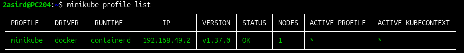

En la tabla resultante comprobamos:
* **PROFILE:** `minikube`
* **DRIVER:** `docker`
* **RUNTIME:** `containerd`
* **IP:** `192.168.49.2` (subred privada administrada por el puente de red virtual de Docker para Minikube, a diferencia de `192.168.59.100` que usaba VirtualBox).
* **STATUS:** `OK` | **NODES:** `1`
* **ACTIVE PROFILE / KUBECONTEXT:** Ambos activos (`*`).

---

### 4.4. Comprobación del nodo con `kubectl`

Inspeccionamos los detalles técnicos del nodo desde la perspectiva de Kubernetes:

```bash
kubectl get nodes -o wide
```

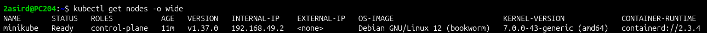

> [!NOTE]
> **Diferencia clave observada entre VirtualBox y Docker:**
> Si comparamos las columnas **OS-IMAGE** y **KERNEL-VERSION** entre ambos entornos:
> - **Con Driver Docker:** El nodo se ejecuta dentro de un contenedor con imagen base **Debian GNU/Linux 12 (bookworm)** y comparte directamente el kernel del sistema anfitrión Ubuntu (**`7.0.0-43-generic`**).
> - **Con Driver VirtualBox:** El nodo se ejecutaba dentro de una máquina virtual independiente con su propia imagen **Buildroot 2025.02.16** y su propio kernel virtualizado (**`6.6.152`**).

---

### 4.5. Tabla Comparativa: VirtualBox vs Docker Driver

| Característica | Driver `virtualbox` | Driver `docker` |
| :--- | :--- | :--- |
| **Aislamiento** | Total (Máquina Virtual independiente con hipervisor) | A nivel de contenedor Linux (comparte kernel anfitrión) |
| **Consumo de Recursos** | Mayor (reserva de RAM y CPU fijas para la VM) | Ligero y elástico (consume recursos bajo demanda) |
| **Tiempo de arranque** | Moderado (~1 a 2 minutos) | Muy rápido (~20 a 30 segundos) |
| **Acceso a NodePort** | Directo a la IP de la VM (`192.168.59.x`) | Requiere `minikube service` o `minikube tunnel` |
| **Imagen de Nodo** | Buildroot Linux independiente | Debian GNU/Linux 12 (kicbase) |
| **Requisitos del Host** | CPU con virtualización (VT-x/AMD-V) | Motor Docker instalado y activo en Linux |

---

## 5. Resumen de Comandos Esenciales de Gestión

| Acción | Comando |
| :--- | :--- |
| **Iniciar clúster** | `minikube start` |
| **Detener clúster (sin borrar datos)** | `minikube stop` |
| **Consultar estado** | `minikube status` |
| **Acceder por SSH al nodo** | `minikube ssh` |
| **Abrir el Dashboard web oficial** | `minikube dashboard` |
| **Obtener la IP del clúster** | `minikube ip` |
| **Eliminar el clúster** | `minikube delete` |
